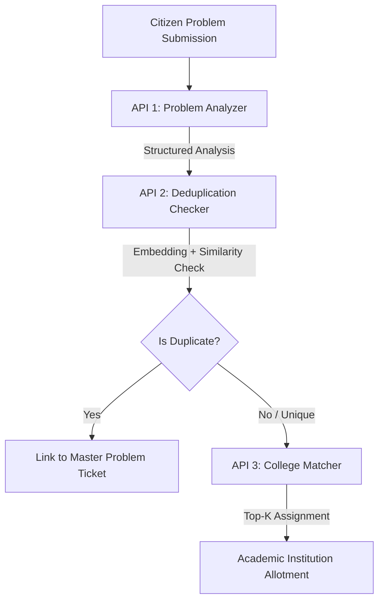

# TeamSetu AI Services Documentation

Comprehensive API documentation for the **Groq Problem Analyzer**, **Multilingual-E5-Large + FAISS Deduplicator**, and **College Matcher** deployed on Hugging Face Spaces.

**Base URL**: `https://abhay958-teamsetu.hf.space`

---

## Architecture Overview



---

## Gradio SSE Two-Step Calling Protocol

Because the service is hosted on a Gradio Space, all API interactions follow a 2-step protocol:
1. **Step 1**: Send `POST /gradio_api/call/<api_name>` with your payload in `{"data": ["{...}"]}`. Receive an `event_id`.
2. **Step 2**: Send `GET /gradio_api/call/<api_name>/<event_id>` to receive the Server-Sent Event (SSE) containing the final JSON.

---

## 1. API 1: Problem Analyzer (Groq AI)

Analyzes a raw text description into category, severity, key points, solutions, and required academic expertise.

* **Endpoint**: `POST https://abhay958-teamsetu.hf.space/gradio_api/call/analyze_problem`
* **Headers**: `Content-Type: application/json`

### Step 1 Request Body
```json
{
  "data": [
    "{\"description\": \"Severe water logging and drainage overflow on Main Market road have caused traffic jams and a foul smell for the past two weeks.\"}"
  ]
}
```
* **Step 1 Response**:
```json
{
  "event_id": "848cbca19ebf4a648cb9ca40464f1412"
}
```

### Step 2 Stream Request
* **Endpoint**: `GET https://abhay958-teamsetu.hf.space/gradio_api/call/analyze_problem/848cbca19ebf4a648cb9ca40464f1412`

### Final Output
```json
{
  "success": true,
  "data": {
    "summary": "Severe water logging and drainage overflow on Main Market road have caused traffic jams and a foul smell for the past two weeks.",
    "key_points": "Water logging and drainage overflow; location: Main Market road; duration: 2 weeks; resulting traffic congestion; foul odor affecting residents and commuters; likely blockage or inadequate drainage capacity.",
    "problem_classification": "water resources",
    "severity": "high",
    "suggested_solution": "Clear blockages in the drainage system and pump out standing water immediately; conduct rapid assessment of drainage capacity.",
    "required_expertise": [
      "Water Resources",
      "Civil Engineering",
      "Urban Planning"
    ]
  }
}
```

---

## 2. API 2: Deduplication Checker (E5-Large + FAISS)

Computes `intfloat/multilingual-e5-large` (1024-dim) vector representations and checks spatial proximity + semantic similarity against existing candidate posts.

* **Endpoint**: `POST https://abhay958-teamsetu.hf.space/gradio_api/call/check_duplicate`
* **Headers**: `Content-Type: application/json`

### Step 1 Request Body
```json
{
  "data": [
    "{\"problem\": {\"summary\": \"Severe water logging and drainage overflow on Main Market road\", \"problem_classification\": \"water resources\", \"key_points\": \"Drainage overflow on Main Road\", \"required_expertise\": [\"Water Resources\", \"Civil Engineering\"]}, \"location\": {\"latitude\": 23.3441, \"longitude\": 85.3096, \"district\": \"Ranchi\"}, \"candidates\": [{\"_id\": \"problem_existing_001\", \"aiAnalysis\": {\"summary\": \"Heavy drainage overflow near market stalls causing water accumulation.\", \"problem_classification\": \"water resources\", \"required_expertise\": [\"Water Resources\", \"Civil Engineering\"]}, \"location\": {\"latitude\": 23.3450, \"longitude\": 85.3100, \"district\": \"Ranchi\"}}, {\"_id\": \"problem_existing_002\", \"aiAnalysis\": {\"summary\": \"Broken street lights causing night safety issues.\", \"problem_classification\": \"energy\", \"required_expertise\": [\"Electrical Engineering\"]}, \"location\": {\"latitude\": 23.4000, \"longitude\": 85.4000, \"district\": \"Ranchi\"}}], \"maxDistanceKm\": 10.0, \"similarityThreshold\": 0.85}"
  ]
}
```

### Step 2 Stream Request
* **Endpoint**: `GET https://abhay958-teamsetu.hf.space/gradio_api/call/check_duplicate/<event_id>`

### Final Output
```json
{
  "success": true,
  "data": {
    "deduplication": {
      "is_duplicate": true,
      "matched_problem_id": "problem_existing_001",
      "similarity_score": 0.9412,
      "distance_km": 0.11,
      "master_ticket_id": "problem_existing_001",
      "matched_problem": {
        "matched_problem_id": "problem_existing_001",
        "similarity_score": 0.9412,
        "distance_km": 0.11,
        "matched_title": "Heavy drainage overflow near market stalls",
        "matched_summary": "Heavy drainage overflow near market stalls causing water accumulation."
      }
    },
    "embedding": [0.02247, -0.02348, 0.04519, -0.0104, "... 1024 floats ..."]
  }
}
```

---

## 3. API 3: College Matcher

Matches a problem against 258 Jharkhand colleges using a multi-factor ranking formula:
$$\text{Score} = 0.35 \times \text{Domain} + 0.35 \times \text{Geo Proximity} + 0.30 \times \text{Semantic Match}$$

* **Endpoint**: `POST https://abhay958-teamsetu.hf.space/gradio_api/call/match_colleges`
* **Headers**: `Content-Type: application/json`

### Step 1 Request Body
```json
{
  "data": [
    "{\"aiAnalysis\": {\"summary\": \"Severe drainage overflow and wastewater pollution\", \"problem_classification\": \"water resources\", \"required_expertise\": [\"Water Resources\", \"Civil Engineering\", \"Hydrology\"]}, \"location\": {\"latitude\": 23.3347, \"longitude\": 85.3137, \"district\": \"Ranchi\"}, \"top_k\": 3}"
  ]
}
```

### Step 2 Stream Request
* **Endpoint**: `GET https://abhay958-teamsetu.hf.space/gradio_api/call/match_colleges/<event_id>`

### Final Output
```json
{
  "success": true,
  "data": [
    {
      "college_name": "DORANDA COLLEGE RANCHI",
      "district": "Ranchi",
      "latitude": 23.334701,
      "longitude": 85.313707,
      "distance_km": 1.13,
      "domain": "water resources",
      "faculty_expertise": "Wastewater Treatment, Environmental Hydrology, River Basin Modeling",
      "infrastructure": "Environmental Engineering Lab, Water Sampling & Analysis Unit, Smart Flow Monitoring Setup",
      "match_score": 92.97,
      "match_breakdown": {
        "domain_score": 1.0,
        "geo_score": 0.98,
        "semantic_score": 0.79
      }
    },
    {
      "college_name": "Uttari Karnpura Shramik Mahavidyalaya, Dakra, Ranchi",
      "district": "Ranchi",
      "latitude": 23.3489,
      "longitude": 85.3272,
      "distance_km": 1.87,
      "domain": "water resources",
      "faculty_expertise": "Wastewater Treatment, Environmental Hydrology, River Basin Modeling",
      "infrastructure": "Environmental Engineering Lab, Water Sampling & Analysis Unit, Smart Flow Monitoring Setup",
      "match_score": 92.46,
      "match_breakdown": {
        "domain_score": 1.0,
        "geo_score": 0.96,
        "semantic_score": 0.79
      }
    }
  ]
}
```

---

## 4. API 4: End-to-End Full Pipeline

Runs all steps in a single call (Problem Analyzer $\rightarrow$ Embedding $\rightarrow$ FAISS Deduplication $\rightarrow$ College Matcher).

* **Endpoint**: `POST https://abhay958-teamsetu.hf.space/gradio_api/call/analyze`
* **Headers**: `Content-Type: application/json`

### Step 1 Request Body
```json
{
  "data": [
    "{\"description\": \"Severe water logging and drainage overflow on Main Market road\", \"location\": {\"latitude\": 23.3441, \"longitude\": 85.3096, \"district\": \"Ranchi\"}, \"candidates\": [], \"topKColleges\": 3}"
  ]
}
```

---

## Node.js Client Helper Example

```javascript
const { Client } = require("@gradio/client");

const SPACE_URL = "abhay958/TeamSetu";

// 1. Analyze Problem
async function analyzeProblem(description) {
  const client = await Client.connect(SPACE_URL);
  const result = await client.predict("/analyze_problem", {
    payload_str: JSON.stringify({ description })
  });
  return JSON.parse(result.data[0]);
}

// 2. Check Duplication
async function checkDuplicate(aiAnalysis, location, candidates) {
  const client = await Client.connect(SPACE_URL);
  const result = await client.predict("/check_duplicate", {
    payload_str: JSON.stringify({ problem: aiAnalysis, location, candidates })
  });
  return JSON.parse(result.data[0]);
}

// 3. Match Colleges
async function matchColleges(aiAnalysis, location, topK = 5) {
  const client = await Client.connect(SPACE_URL);
  const result = await client.predict("/match_colleges", {
    payload_str: JSON.stringify({ aiAnalysis, location, top_k: topK })
  });
  return JSON.parse(result.data[0]);
}

module.exports = { analyzeProblem, checkDuplicate, matchColleges };
```
